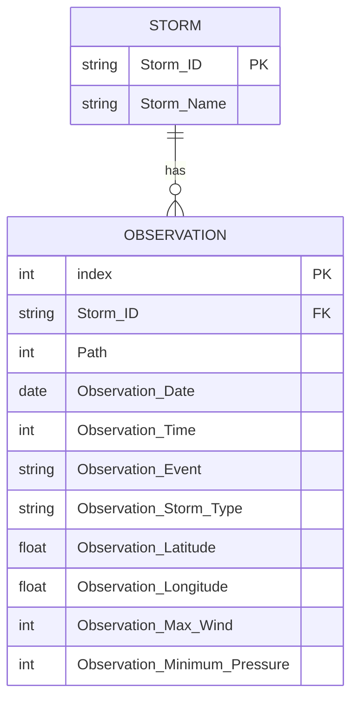

# Entidades, relaciones y diagrama

## Entidades

- **Storm:** representa una tormenta. Sus atributos principales son `Storm_ID` (clave primaria) y `Storm_Name`.
- **Observation:** representa una observación de la trayectoria de una tormenta. Incluye `index` como clave primaria, `Storm_ID` como clave foránea y los datos de fecha, ubicación, tipo, viento y presión.

## Relación

Una tormenta puede tener cero o muchas observaciones, mientras que cada observación pertenece a una sola tormenta. La relación es `Storm (1) ---- (N) Observation`.

- **Cardinalidad:** 1 a N (uno a muchos).
- **Clave foránea:** `Storm_ID` en `Observation` referencia a `Storm_ID` en `Storm`.
- `Path` funciona como el número de secuencia de cada observación dentro de la trayectoria de su tormenta (no es una clave, solo indica el orden).

## Diagrama entidad-relación

